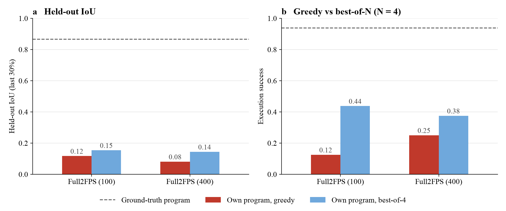
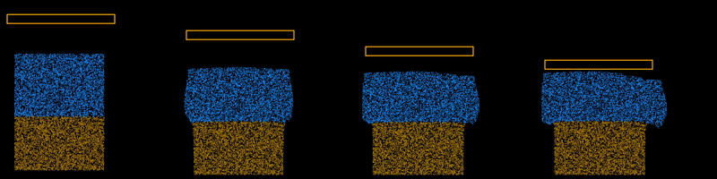
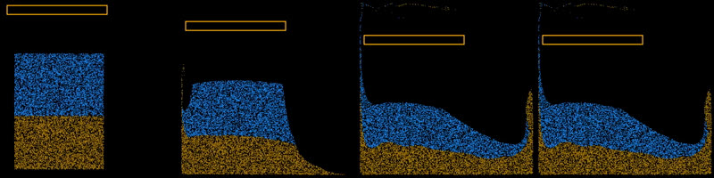

# Frame-rate ablation

How does the temporal sampling rate of the input video affect whether Qwen3-VL-4B can recover the physics of a
scene and write a Taichi MPM program that runs and reproduces it?

This track differs from the main configs (`scripts/build_sft_data.py`) in its input and target:

| | main track (C1–C4) | frame-rate track |
|---|---|---|
| video | 16 frames from the first 70% | the whole 10 s clip, sampled by the model at 30 / 10 / 2 FPS (300 / 100 / 20 frames) |
| text | material (+ geometry, motion) | the complete `scene.yaml` and `scene_spec.json` |
| target | `<physics>` JSON + program | the original `program.py`, verbatim |
| scored on | physics and code tracks | code track only (no `<physics>` block) |

Splits are the same parent-family splits (1600 / 200 / 200). Every frame gets 128 visual tokens, so the frame rate
sets the context length: the longest training sample is 27.5k tokens at 30 FPS, 14.6k at 10 FPS and 9.5k at 2 FPS.

## Files

| path | role |
|---|---|
| `prepare_data.py` | ms-swift records for one frame rate; `--scaffold` appends the MPMWorlds-style program skeleton to the prompt |
| `train.sh` | LoRA SFT: `pilot` (rank 16, a fixed number of steps) or `full` (rank 64, 2 epochs) |
| `generate.py` | greedy + N−1 samples (T = 0.7, top-p 0.95) on the test scenes, in the `scripts/evaluate.py` format |
| `score.py` | runs every program and scores it with `scripts/evaluate.py` (greedy and best-of-N) |
| `run_gpu.sh` | the whole experiment on one A100 80GB, resumable stage by stage |
| `test_scenes.json` | the 16 test scenes (one per parent family) used for every frame-rate run |
| `results/` | `summary.json` and per-scene `scores.jsonl` of every run, the Full2FPS training log |
| `figures/` | bar chart and keyframe comparison used in the report |

## Method

1. **Equal-step pilot.** One LoRA per frame rate (rank 16, alpha 32, lr 1e-4, effective batch 8), trained for the
   same 46 optimizer steps, then greedy generation on the 16 test scenes (4,500-token limit). The 2 FPS adapter is
   also run with the program scaffold appended to the prompt.
2. **Full2FPS.** 2 FPS with the scaffold in every training and test prompt; LoRA rank 64, alpha 128, dropout 0.05
   on all linear layers of the language model (vision encoder and aligner frozen); lr 1e-4, cosine, 3% warm-up;
   effective batch 8; 2 epochs = 400 steps. Validation loss every 100 steps. We evaluate checkpoint 100 (lowest
   validation loss) and checkpoint 400 (end of training).
3. **Evaluation.** For each scene, 1 greedy + 3 sampled programs. Best-of-4 takes the first program that runs (the
   selection never looks at the ground truth). Programs run in Taichi with a 900 s limit. Metrics follow
   `scripts/evaluate.py`: sim success, occupancy IoU on the first 70% (fill IoU) and on the held-out last 30%,
   W-MAE and object collapse (OCS) on the held-out part. Failed programs score IoU 0, W-MAE 1, OCS 1.

The scaffold keeps imports, `ti.init` and function signatures; every numeric constant and default value is removed,
so the model must still infer all physical quantities. It does reveal the function structure of the reference
program, as in MPMWorlds.

## Results

16 test scenes. Base Qwen3-VL-4B = the 46-step 2 FPS pilot with the scaffold prompt (greedy), the least-trained
model. Full2FPS rows are best-of-4.

| config | fill IoU (first 70%) ↑ | sim success ↑ | IoU (held-out) ↑ | W-MAE (held-out) ↓ |
|---|---|---|---|---|
| Base Qwen3-VL-4B | 0.000 | 0 / 16 | 0.000 | 1.000 |
| Full2FPS (100) | 0.230 | 7 / 16 | 0.154 | 0.915 |
| Full2FPS (400) | 0.172 | 6 / 16 | 0.144 | 0.826 |
| ground-truth program | 0.855 | 15 / 16 | 0.866 | 0.199 |

Equal-step pilot (greedy): 0 / 16 programs run at 30, 10 and 2 FPS, and with the scaffold; valid Python 69%, 75%,
69% and 81%. Full2FPS greedy: 2 / 16 (checkpoint 100) and 4 / 16 (checkpoint 400) run.



Scene 000670, frames 30 / 120 / 210 / 285. Top: ground-truth program. Bottom: Full2FPS (100), best-of-4. The program
runs, but the lower block flows like a liquid instead of staying intact (IoU first 70% 0.69, held-out 0.00, OCS 0.96).




Findings:

- **A low frame rate limits physics inference.** Full training at 2 FPS gives programs that run, but held-out IoU
  stays near 0.15 against 0.87 for the ground truth: the code is valid, the dynamics are wrong. At 2 FPS one frame
  covers 0.5 s, so short events (contact, rebound, onset of collapse) fall between frames. The equal-step pilot
  could not compare frame rates directly (0 / 16 everywhere), so this rests on the 2 FPS failure pattern.
- **400 steps overfit.** Validation loss is lowest at step 100 (0.308) and rises to 0.342 at step 400; best-of-4
  is no better (6 vs 7 runnable), held-out IoU is slightly lower, and the gain from extra samples shrinks. Held-out
  W-MAE is better at step 400; all differences are inside the 16-scene confidence intervals.

## How to run

Requirements: ms-swift 4.6, transformers 4.57, torchcodec 0.7, taichi 1.7.4, ffmpeg; the MPMWorlds scenes unzipped
in `data/SFT-2000` (with `canonical_records.jsonl`).

```bash
# everything on one A100 80GB, resumable (Full2FPS alone: about 2 h training + 1 h generation per checkpoint)
bash framerate/run_gpu.sh

# or step by step
python framerate/prepare_data.py --source data/SFT-2000 --out data/fps/fps_2s --fps 2 --scaffold
bash framerate/train.sh full data/fps/fps_2s 2
python framerate/generate.py --data data/fps/fps_2s --fps 2 --adapter runs/framerate/fps_2s/full/checkpoint-400 \
  --samples 4 --out runs/framerate/fps_2s/full/ck400/pred.jsonl
python framerate/score.py --data data/fps/fps_2s --pred runs/framerate/fps_2s/full/ck400/pred.jsonl
```

Checkpoint 400 of this run is the starting model **A** of the RL track (`rl/`).
